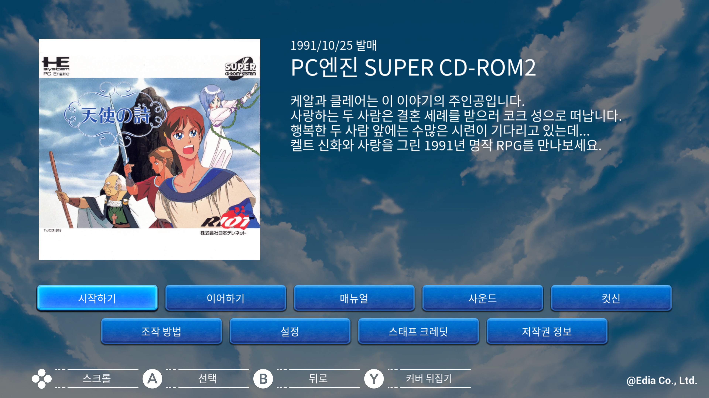

# 천사의 시 — Nintendo Switch

Nintendo Switch **천사의 시** 한글 번역 패치 프로젝트입니다. 마을과 필드를 탐험하며 이야기를 진행하는 판타지 RPG의 Switch판입니다.

> **현재 최종 모드 패치 배포본**

<!-- game-preview:start -->

  

**게임 소개·한글 메뉴** — 사용자가 Citron에서 촬영한 Switch판 게임 소개·한글 메뉴 화면입니다. 현재 설치 패치와 공개 배포본의 일부 컨테이너가 달라 최종 배포본과 동일한 화면으로 확정하지 않았습니다.
<!-- game-preview:end -->

## 다운로드 및 적용 방법

1. 보유한 Switch판 게임의 Title ID가 `010096F021294000`인지 확인합니다.
2. [최종 배포 패치 다운로드](https://github.com/akuma815/switch-tenshi-no-uta-kr-patch/releases/tag/release-current)에서 압축 파일을 받아 모두 해제합니다.
3. 모드 폴더의 `romfs/Emulator_Tenshinouta/Content/Paks/` 안에 패치 파일 4개를 함께 복사합니다.
4. Atmosphere는 `atmosphere/contents/010096F021294000/romfs/Emulator_Tenshinouta/Content/Paks/` 경로를 사용합니다. 게임을 완전히 종료한 뒤 다시 실행합니다.

## 주의사항

- Title ID 010096F021294000 전용 RomFS LayeredFS 모드입니다.
- 원본 컨테이너를 교체하지 말고 패치 파일 4개를 함께 설치하세요.
- 이번 등록은 기존 모드 파일의 포장과 정적 검사이며 새 게임 실행 검수는 하지 않았습니다.
- 원본 게임·BIOS 및 패치가 적용된 게임 이미지는 포함하지 않습니다.

## 체크섬

| 구분 | SHA-256 |
| --- | --- |
| 모드 패치 `TenshiKR_Font_P.pak` | `efc859e73092b6c08ece04876559f8fb0d7b97b0869f47afd942d68a7d8b511c` |
| 모드 패치 `TenshiKR_P.pak` | `75e7144577253917f6da7312ef5e585b12fb728226a22b0938323751a6b555cd` |
| 모드 패치 `TenshiKR_P.ucas` | `f2e83254795e4475a7b266fbe8957f08981dc5c80d7e5c17cbd455dcb6bf6e5b` |
| 모드 패치 `TenshiKR_P.utoc` | `bde251e17bdc68a1d4fffdd0f9d63146e38b42789552798a0ec828f5b7155acc` |
| 배포 압축 파일 | `833d877c22d85253e70183360abdf788252ccbcbb2bd7ab1964983d7c298e9af` |

지원 원본의 세트·리비전 및 해시는 [상세 패치 안내](docs/PATCH_GUIDE.txt)를 확인하세요.

## 소스 및 작업 기록

[공개 소스 구성과 빌드 전제](docs/SOURCE_GUIDE.md) · [상세 패치 안내](docs/PATCH_GUIDE.txt)

[2026-10-16 최종 빌드 재현·폴더 삭제 검토](docs/REBUILD_2026-10-16.md)
